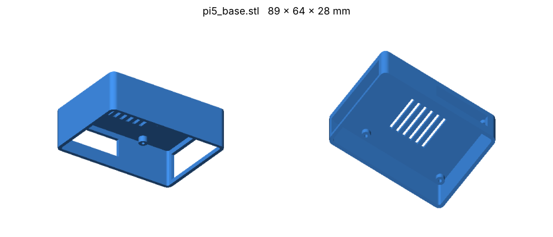
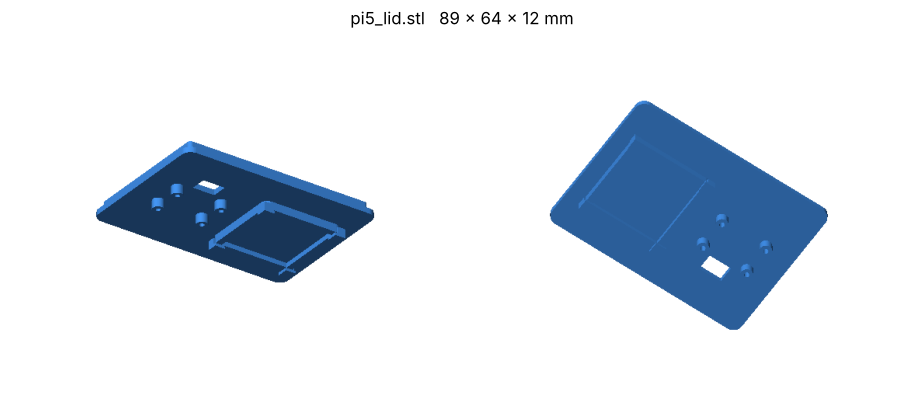
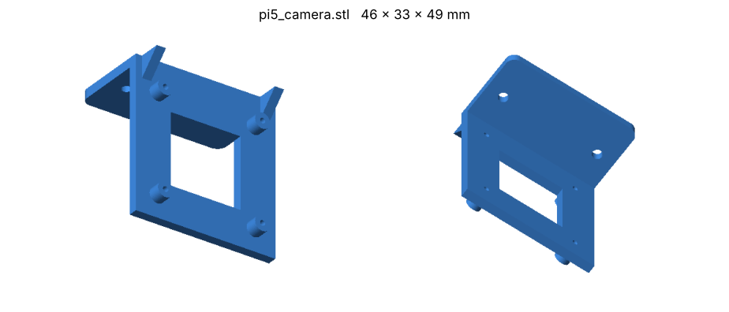

# 3D-Printed Parts (CAD)

STL files for the 3D-printed enclosure and camera mount used to build the logger
around a **Raspberry Pi 5**. All files were exported from OpenSCAD; units are
**millimetres**.

GitHub renders `.stl` files in an interactive 3D viewer — click any file below
to rotate/zoom it in the browser.

| File | Part | Bounding box (X × Y × Z) | Qty |
|------|------|--------------------------|-----|
| [`pi5_base.stl`](pi5_base.stl) | Enclosure base (tray the Pi sits in) | 89 × 64 × 28 mm | 1 |
| [`pi5_lid.stl`](pi5_lid.stl) | Enclosure lid | 89 × 64 × 11.9 mm | 1 |
| [`pi5_camera.stl`](pi5_camera.stl) | L-bracket camera mount | 46 × 33 × 49 mm | 1 |

## Parts

### `pi5_base.stl` — enclosure base

- Open-top tray with four mounting standoffs on a **58 × 49 mm** pattern — the
  Raspberry Pi 5 mounting-hole spacing.
- Side-wall cut-outs for the Pi's USB / Ethernet and side ports, so the camera,
  GPS, and power cables plug in with the lid on.
- Ventilation slots in the floor.

### `pi5_lid.stl` — enclosure lid

- Flat lid with a locating lip that drops into the base.
- Rectangular slot for passing a cable through (e.g. the BNO085 STEMMA QT / I2C
  lead — see the [wiring diagram](../../docs/HARDWARE_SETUP.md#wiring-diagram)).
- Four small posts (10 × 7 mm pattern) and a raised rectangular frame on the
  inside face.

### `pi5_camera.stl` — camera mount

- L-shaped bracket: a vertical plate holds the USB camera board, the horizontal
  foot attaches to the enclosure / vehicle mount.
- Square window in the vertical plate for the lens, with four standoffs on a
  **32 × 32 mm** hole pattern for the camera board.
- Two screw holes through the foot.

## Printing notes

- The models are oriented as exported; check orientation in your slicer before
  printing (the lid and camera bracket may print better rotated so the largest
  flat face is on the bed).
- For a logger that lives outdoors on a bike/robot, PETG or ASA hold up much
  better than PLA, which softens in direct sun.

## Assembly

See [`docs/HARDWARE_SETUP.md`](../../docs/HARDWARE_SETUP.md) for how the
camera, GPS, IMU, power and storage connect to the Pi.

The preview images in `previews/` are rendered from the STLs; regenerate them
if a part is changed.
